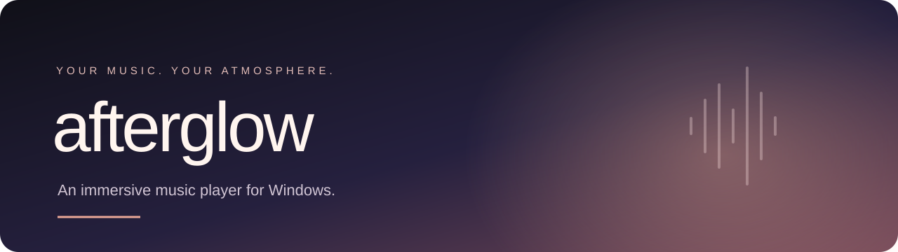
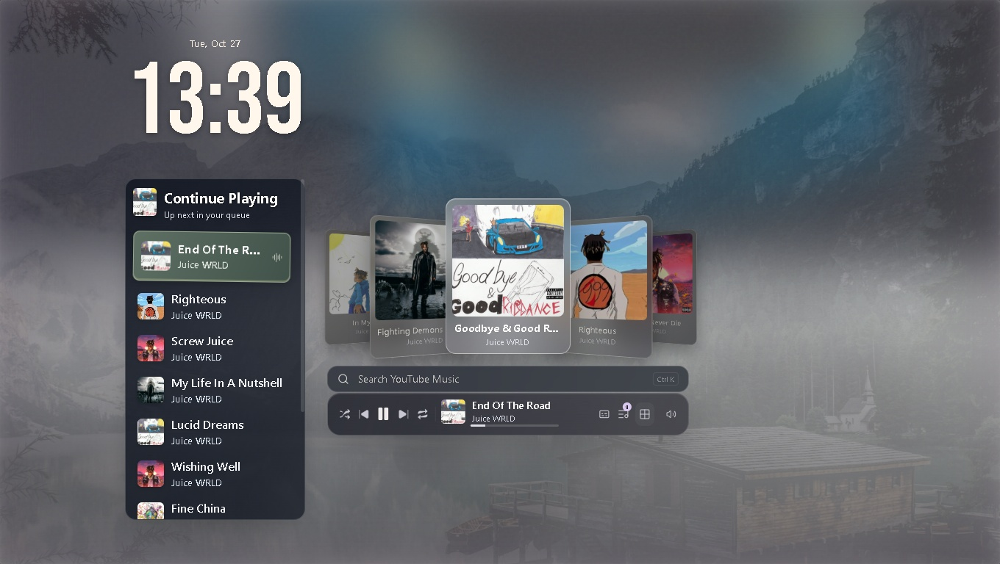
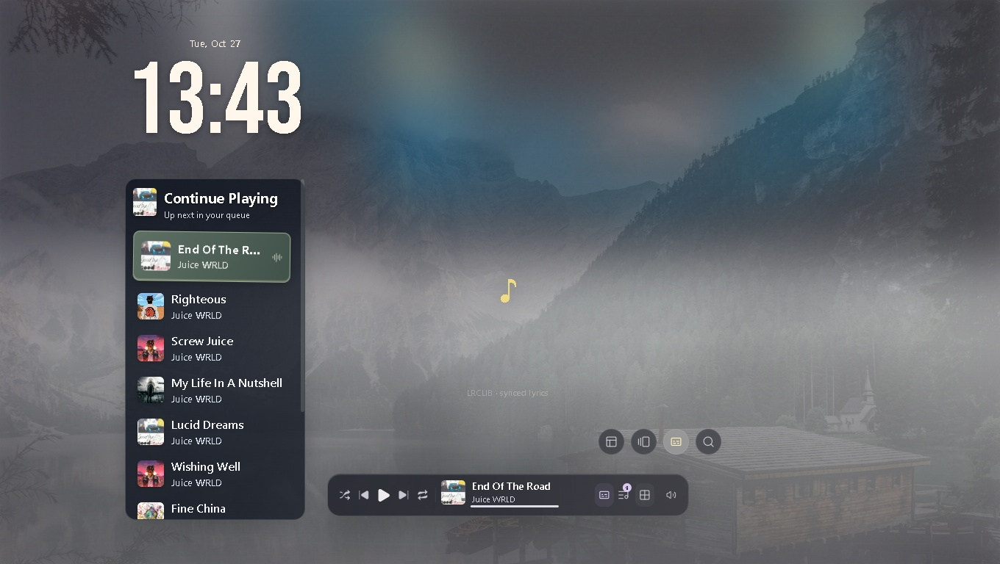
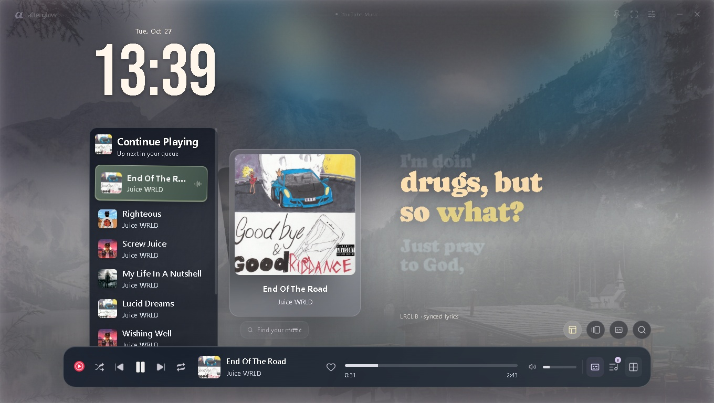
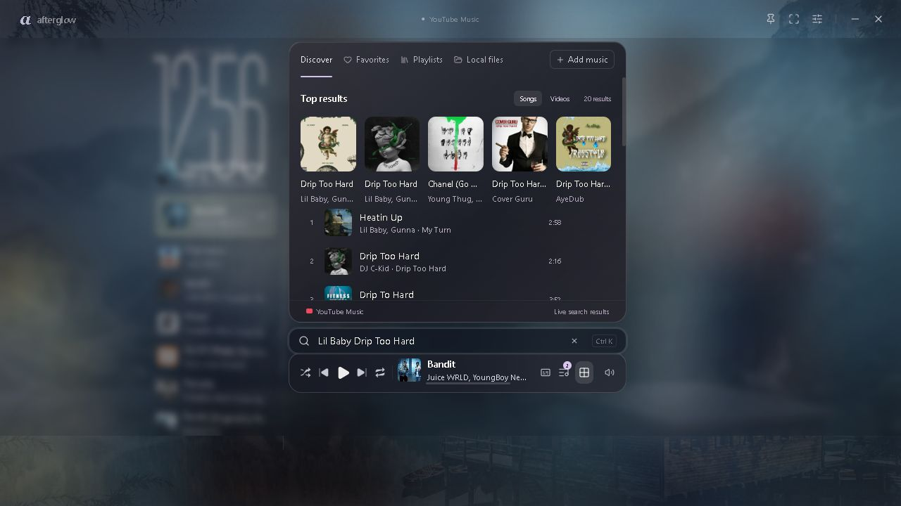

<div align="center">



<br />

**Music that becomes part of your desktop.**

Cinematic backgrounds · Synced lyrics · Floating controls · A glass album carousel


[Get started](#get-started) · [Explore the views](#explore-the-views) · [Controls](#controls) · [Development](#development)

</div>

---

Afterglow is a Windows desktop music player built around atmosphere: full-window music videos, translucent floating controls, a dimensional album carousel, and lyrics that move with the song. Search YouTube Music, build a queue, save favorites, organize playlists, or import your own audio.

The project currently runs **unpacked from source**. There is no installer or packaged application EXE; Electron supplies the development runtime. Typography, layout and animation performance are still being refined.

## Explore the views

### Album carousel

A layered cover fan, a tilted Continue Playing queue, and a compact search and playback bar.



<table>
<tr><th width="50%">Cinema lyrics</th><th width="50%">Cover + lyrics</th></tr>
<tr><td></td><td></td></tr>
<tr><td>Let the background fill the window while short lyric phrases take the stage.</td><td>Keep the cover anchored beside the lyrics as the song progresses.</td></tr>
</table>

<details>
<summary><strong>See the search interface</strong></summary>



</details>

<sub>The three playback images combine sequential captures of the native video and UI layers. The search image shows the UI renderer. These are development captures, not final release artwork.</sub>

## What is inside

| Experience | Features |
| --- | --- |
| **Listen** | YouTube Music search, song and video results, local audio import, playback seeking, shuffle and repeat |
| **Make it yours** | Queue, favorites, playlists and history saved locally |
| **Set the scene** | Album, cinema and split layouts; video, artwork, landscape and custom backgrounds |
| **Read along** | Synced lyric lookup, short phrase presentation, lyric size and timing adjustment |
| **Move naturally** | Swipe the main cover to change songs; click to play or pause |
| **Tune the desktop** | Clock, full screen, always on top, brightness, blur and glow settings |
| **Choose the motion** | Follow Windows reduced motion or enable full animations within Afterglow |
| **Reduce interruptions** | Ghostery network filtering plus detection, muting and skipping of in-stream ads |

## Get started

You need Windows, Node.js 22.12 or newer (a current LTS release is recommended) with npm, and an internet connection for online search and playback. Git is optional if you download the source ZIP.

```powershell
git clone https://github.com/smithcooks/afterglow.git
cd afterglow
npm ci
npm start
```

Prefer double-click launchers? Run **Setup Afterglow.cmd** once, then open **Start Afterglow.cmd**. Setup downloads the dependencies and Electron runtime into the project folder.

1. Open the library or search field and find a song.
2. Select a result to begin playback.
3. Use Appearance settings to choose Album carousel, Cinema lyrics, or Cover + lyrics.
4. Adjust the background and motion settings to your preference.

> If `npm start` opens Electron as Node instead of opening the player, clear `ELECTRON_RUN_AS_NODE` in that shell. The included Start launcher already clears it.

## Controls

| Input | Action |
| --- | --- |
| `Space` | Play / pause |
| `←` / `→` | Seek backward / forward by 5 seconds |
| `Ctrl` + `←` / `→` | Previous / next song |
| `Ctrl` + `K` | Open music search |
| `L` | Toggle lyrics |
| `F` | Toggle full screen |
| `Esc` | Close the current overlay or leave full screen |
| Swipe the main cover left / right | Change to the neighboring song |
| Click the main cover | Play / pause |

## Playback and ad protection

YouTube Music plays in an isolated Electron view behind the local interface. Network filtering starts before online playback. A second layer detects in-stream ad states, mutes and skips those segments, and restores the song's original mute state and playback speed.

Live verification has recorded an ad segment being suppressed followed by successful song playback. YouTube can change its delivery behavior, so complete ad removal on every future session is **not guaranteed**. Regional restrictions and source-player consent requirements may still affect playback. The source-player button opens the underlying player when needed.

The current implementation uses **Electron, YouTube.js and Ghostery's adblocker**. It does not use NewPipe, MediaPipe, ExoPlayer or VLC.

## Development

```powershell
npm run check   # Parse all application, script and test JavaScript
npm test        # Run the automated test suite
npm run preview # Open the UI preview server; not the native playback app
```

The current suite has **18 passing tests**, covering persistence, input validation, HTTP security boundaries, queue behavior, swipe recognition, carousel ordering, lyric phrase timing and wrapping, song metadata stability and ad handling.

### Layout of the project

```text
src/              Electron shell, playback, catalog, persistence and local API
ui/               Interface, styles, gestures, carousel and lyric timing
ui/assets/        Fonts, icons, wallpaper and bundled blocker data
scripts/          Syntax checks and live playback / visual verification
tests/           Automated tests
docs/images/     README banner and development screenshots
```

### How it works

- **Desktop shell:** Electron BaseWindow with a sandboxed source-player view and a transparent local UI view.
- **Catalog:** YouTube.js for search and discovery; LRCLIB for synced lyric lookup.
- **Local API:** A loopback server with origin and host checks, explicit actions and server-sent playback updates.
- **Storage:** A local JSON library with validated settings and recovery for invalid saved data.
- **Interface:** HTML, CSS and JavaScript with bundled fonts and Lucide icons.

### Live verification

Launch the app with `AFTERGLOW_VERIFY_UI=1` to enable development-only inspection and screenshot actions, then run:

```powershell
node scripts/live-check.cjs
node scripts/reference-check.cjs
node scripts/verify-transitions.cjs
```

These checks exercise playback, pause / resume, seeking, the three player layouts, fixed-cover geometry, track transitions and full-window video bounds. Screenshots and reports are written to `screenshots/`, which is excluded from Git except for the curated copies under `docs/images/`.

## Current status

Afterglow is an active development project. Core playback and the three layouts are implemented; layout details and smooth animation remain under review. The clock font, text proportions, glass treatment and frame pacing still need polish.

Lyrics use source line timestamps. Long lines are split proportionally into short phrases, so this is **not word-level lyric alignment**. Online playback and lyrics depend on third-party service availability.

### Next up

- [ ] Refine typography, glass surfaces and layout proportions.
- [ ] Improve frame pacing and validate lyric and carousel motion in the foreground.
- [ ] Expand live playback checks across more tracks and ad cases.
- [ ] Continue polishing search, queue and layout transitions.

## Your local data

Favorites, playlists, queue, history, settings and the playback profile live in `.afterglow-data/`. Imported audio and custom backgrounds remain in their original locations; Afterglow stores their file paths. Keep that folder when updating your local copy. It is excluded from the repository along with dependencies, caches, logs and temporary verification output.

## Credits

| Component | Project | License / source |
| --- | --- | --- |
| Desktop runtime | [Electron](https://github.com/electron/electron) | MIT |
| Search and discovery | [YouTube.js](https://github.com/LuanRT/YouTube.js) | MIT |
| Network filtering | [Ghostery adblocker](https://github.com/ghostery/adblocker) | MPL-2.0 |
| Icons | [Lucide](https://github.com/lucide-icons/lucide) | ISC; bundled notice in `ui/assets/lucide-LICENSE.txt` |
| Fonts | Tulpen One, Caprasimo, Bebas Neue | Bundled OFL notices in `ui/assets/` |
| Synced lyrics | [LRCLIB](https://lrclib.net) | Third-party lyric service |

Afterglow is an independent music player and is not affiliated with YouTube or Google. Music, video, album artwork and lyrics belong to their respective owners.

---

<div align="center"><sub>Built for the moments when the music stays with you.</sub></div>
